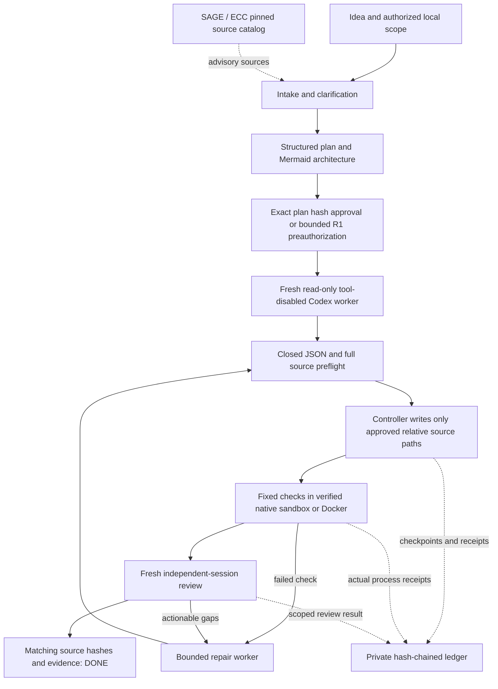

# SAGE — Bounded Autonomous Runtime 0.1 / اجرای خودکارِ محدود

Source-branch extension, approved 2026-10-24. This document supplements rather
than rewrites the preserved 0.8.0 baseline, 0.8.4 SDK or existing release tags.

## هدف و تعریف تکمیل

لایهٔ تازه، انتخاب و حمل منابع SAGE/ECC را به یک مجری واقعی وصل می‌کند:
ایده و ابهام‌زدایی، طرح و دیاگرام، تأیید برنامه، تولید فایل، آزمون در محیط
ایزوله، بازبینی در نشست مستقل و اصلاح محدود. پایان موفق فقط با شواهد منطبق
با هش فایل‌های فعلی اعلام می‌شود. این تعریفی برای ساخت هر نوع محصول بدون
محدودیت، تضمین بی‌خطایی یا گواهی امنیت نیست.

## Ownership and authority

SAGE owns task, plan, approvals, budgets, source application and completion.
ECC remains an attributed on-demand source library; no imported prompt, model
name, hook, command, memory engine or tool allowlist grants authority. The
PowerShell reference lifecycle stays Dry-Run. The new executable package is
opt-in, separately named `sage-runtime`, and has its own 0.1.0 version.

Initial consent binds an idea, a new absolute output path, a private evidence
root, finite limits and a task-specific approval identifier. Plan approval is
by exact hash; optional preauthorization accepts only a ready R1 local plan
within the same grant. Higher risks, external actions, dependencies and missing
execution profiles stop for human review. No installer, release, public host,
production target, Strix scan or credentials are activated as a side effect.

## Actual execution architecture

The first model adapter uses `codex exec` with structured output, read-only
sandboxing, disabled host tools/hooks/plugins/MCP discovery, no inherited user
configuration and a fresh empty working directory. The worker returns file
contents as data; it cannot directly mutate a project or authorize a command.
Controller invocations are capped and recorded before launch, including failed
attempts. Built-in CLI HTTP/SSE retry policy is not a precise monetary budget;
no unlimited retry, automatic provider fallback or model substitution is added.

Generated source is checked in a separate sandbox. Native execution requires
successful outside-read/write, source/Git-write and network-denial canaries.
Unavailable native isolation is not downgraded. Docker is an explicit fallback
using a locally provisioned image resolved to its immutable ID, no automatic
pull, network disabled, read-only source/root filesystem, non-root user, dropped
capabilities, no-new-privileges and CPU/RAM/PID ceilings. No home/auth is mounted.
Only exact owned processes and disposable containers may be terminated.

The trusted Python verifier supervises project tests in a child, rejects forged
completion markers, zero tests, skips, expected failures and early exits. This
is not cryptographic test attestation against a fully malicious interpreter;
behavioral acceptance and independent review remain necessary. Browser-native
HTML checks do not prove rendering, accessibility or JavaScript behavior.

## Persistence, recovery and evidence

- Immutable checkpoint snapshots are committed by an append-only hash-chain
  ledger. Partial/uncommitted snapshots are not promoted to progress.
- Changed plan/review artifacts get new content-addressed paths rather than
  overwriting evidence referenced by an older checkpoint. The status response's
  `artifacts` map identifies the latest committed logical artifact paths.
- OS-released per-run locks prevent concurrent writers. Resume preserves call,
  elapsed-time and repair budgets; interrupted unobserved work is charged
  conservatively rather than reset.
- Source writes have a durable validated intent. Partial writes are replayed
  only when every observed file equals its exact before/after hash; unexplained
  edits block recovery and are never overwritten.
- Evidence lives outside generated source. A successful model statement is
  not a test receipt. Final plan/source/verification/review hashes must match.
- Existing projects are imported only as an explicitly selected, bounded
  source snapshot into a new isolated output; the original is not modified.
- Local hash chaining detects corruption, not a privileged actor rewriting
  every file. File fsync/atomic replacement do not assert Windows power-loss
  guarantees or replace operating-system access controls.

## Compatibility and verification

Initial fixed profiles: `python-stdlib`, `node-stdlib`, `static-web`. The actual
host must provide each required interpreter and a proven isolation backend;
Node is not automatically emulated by the Python Docker fallback. Unsupported
stacks stop visibly, without replacing the requested language.

The installable wheel includes the attributed, hash-verified source closure
needed for catalog selection, not an automatic native ECC installation.
Offline controller/policy/transport/package tests and representative live
acceptance are distinct evidence classes. CI must not invoke authenticated
models. A live acceptance script is separate and enforces a shared 12-call cap.

Implementation: [runtime/autonomous](runtime/autonomous/README.fa-en.md).
Official adapter reference consulted 2026-10-24:
[Codex non-interactive mode](https://learn.chatgpt.com/docs/non-interactive-mode).
Container constraints:
[Docker run reference](https://docs.docker.com/engine/containers/run/).
