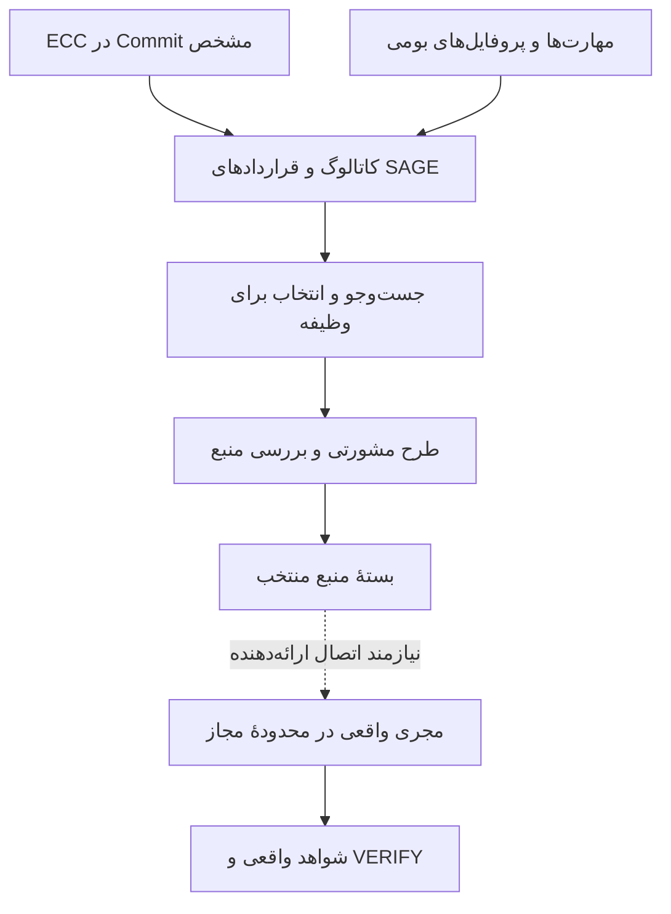

# SAGE — ECC Capability Extension 0.1

تاریخ: 2026-10-23 (UTC). افزونهٔ منبع: `0.1.0`. هستهٔ سازگار: `sage/0.8.4`.

وضعیت این تغییر طبق [manifest](extensions/ecc/manifest.json)، `REVIEW_CANDIDATE_SOURCE_CATALOG` است: ECC در قالب منابع نسخه‌دار، تطبیق‌های قابل‌بازبینی، قراردادهای قابل‌حمل و آداپتور آفلاین وارد مسیر کشف SAGE می‌شود. این سند مرز افزوده و معیار اتصال بعدی به اجرا را مشخص می‌کند. راهنمای عملی و فرمان‌ها در [README فارسی/انگلیسی افزونه](extensions/ecc/README.fa-en.md) قرار دارند.

## ۱. مسئله و نتیجهٔ معماری

SAGE به روش‌ها و تخصص‌های مکمل نیاز دارد، در حالی که چرخهٔ انجام کار، محدودهٔ مجاز، انتخاب فناوری و ارزیابی نتیجه باید یک مالک روشن داشته باشند. ECC مجموعهٔ بزرگی از Skill، نقش، راهنما، اسکریپت و فرض‌های میزبان دارد. این افزونه هر تعریف اصلی را با یک شناسهٔ namespaced، منشأ دقیق، تصمیم تطبیق و پیوند به مسئولیت موجود SAGE معرفی می‌کند.

نتیجهٔ قابل‌استفاده، یک کاتالوگ محلی و بسته‌های منبع برحسب انتخاب است. نقش‌های ECC می‌توانند روش بازبینی، تخصص زبان، شیوهٔ برنامه‌ریزی یا دانش حوزه‌ای به وظیفه اضافه کنند؛ تخصیص ابزار، اختیار اجرا و پذیرش نتیجه در قرارداد SAGE باقی می‌ماند. مبنای این تصمیم [قرارداد اجرا و Skill](SAGE_v0.8_EXECUTION_PROTOCOL_AND_SKILL_CONTRACT.md)، [افزونهٔ مهندسی فناوری](SAGE_v0.8_TECHNOLOGY_ENGINEERING_DELTA.md) و [سیاست ECC](extensions/ecc/policy.json) است.

## ۲. مبنا، پوشش و تعبیر اعداد

| موجودی | مبنای نسخه | تعداد تعریف |
|---|---|---:|
| Skillهای اصلی ECC | `90606c8315ee09cafc303515c5f33024db6b9882` | 311 |
| فایل‌های agent اصلی ECC | همان Commit | 71 |
| Skillهای بومی SAGE | `46e65164f726d902d360b3be341bd6f35171c982` | 26؛ شامل 8 هسته و 18 مهندسی فناوری |
| پروفایل‌های متخصص بومی SAGE | همان Commit | 17 |
| کاتالوگ ترکیبی | هر دو مبنای بالا | **425؛ شامل 337 Skill و 88 تعریف نقش / پروفایل** |

این اعداد موجودی تعریف‌ها هستند. یک وظیفه ممکن است از چند تعریف همپوشان استفاده کند؛ یک تعریف هم ممکن است چند روش را پوشش دهد. بنابراین جمع 425، شمار قابلیت‌های مستقل، تخصص‌های اثبات‌شده یا agentهای در حال اجرا نیست. مقدار `execution_verified_definitions` برای این ادغام منبع، صفر ثبت می‌شود. [سازنده](tools/Build-SageEccCatalog.py)، [کاتالوگ](extensions/ecc/catalog.json) و [اعتبارسنج](tools/Verify-SageEccCatalog.py) منابع این شمارش‌اند.

پوشش canonical بر `skills/*/SKILL.md` و `agents/*.md` ECC تکیه دارد. تمام منابع محلی پوشهٔ هر Skill حفظ و فهرست می‌شوند. اسناد، فرمان‌ها، hookها، اسکریپت‌ها و تنظیمات پشتیبان منتخب به‌صورت منبع غیرفعال در vendor قرار می‌گیرند؛ موجودی سایر فایل‌های tracked نیز با هش و وضعیت حفظ می‌شود. ترجمه‌ها و کپی‌های ابزارها شمار Skill تازه ایجاد نمی‌کنند. [قفل upstream](extensions/ecc/upstream-lock.json) و [تفکیک اجزا](extensions/ecc/review/component-dispositions.json) این مرز را ثبت می‌کنند.

## ۳. تصمیم تطبیق به‌ازای هر تعریف

| تصمیم | تغییر حاصل | شاهد تصمیم |
|---|---|---|
| `ADD` | یک حوزه یا روش مکمل با قرارداد SAGE در کاتالوگ قابل‌انتخاب می‌شود. | دلیل نیاز، دامنه و حدود همان ورودی |
| `ENHANCE` | تعریف ECC به مسئولیت موجود SAGE پیوند می‌خورد. | `sage_targets` و توضیح ارزش افزوده |
| `REFERENCE_ONLY` | متن برای مطالعه و اقتباس حفظ می‌شود؛ ورود آن به بستهٔ فعال رد می‌شود. | تعارض یا وابستگی معماری و مرز قابل‌استفاده |
| `KEEP` | تعریف موجود SAGE در کاتالوگ یکپارچه دیده می‌شود. | منبع بومی در Commit مبنا |

همپوشانی به معنی بازنویسی بی‌قیدوشرط Skill موجود یا ادغام همهٔ دستورهای upstream در سیاست هسته نیست. برای نمونه، `code-reviewer` به `engineering-qa` و `sage-verify` متصل می‌شود؛ ارزش آن، تمرکز روی diff، شاهد شدت و حذف یافته‌های کم‌اطمینان است. دستور بومیِ بازبینی همیشگی یا آستانهٔ ثابت پوشش، گیت متناسب SAGE را تعیین نمی‌کند. `planner` نیز ورودی مشورتی `sage-plan` است و کنترل چرخهٔ اصلی را در اختیار نمی‌گیرد. [بازبینی نقش‌ها](extensions/ecc/review/agents.json) این نمونه‌ها را توضیح می‌دهد.

تصمیم کامل هر 311 Skill و 71 نقش در [ماتریس تطبیق](extensions/ecc/review/OVERLAP-MATRIX.fa.md) ثبت می‌شود. تعداد `ADD` و `ENHANCE` باید از `summary.decisions` نسخهٔ ساخته‌شده خوانده شود تا سند روایی شمارش مستقل و ناسازگار ایجاد نکند.

## ۴. مسیر داده و مسئولیت

پیکان اتصال ارائه‌دهنده، کار بعدی را نشان می‌دهد. آداپتور فعلی تا ایجاد بستهٔ منبع پیش می‌رود و مجری راه‌اندازی نمی‌کند. `plan` برای پیشنهاد و بررسی اولیه است؛ `bundle` مستقیماً نیز شناسه‌های صریح را می‌پذیرد، زیرا ساخت بسته به‌خودی‌خود اجرای وظیفه نیست. [آداپتور](extensions/ecc/sage_ecc.py) رفتار فعلی را تعریف می‌کند.

| لایه | پیاده‌سازی و مسئولیت |
|---|---|
| منشأ | منبع اصلی، Commit، URL نسخه‌دار و SHA-256 در کاتالوگ و قفل |
| تطبیق | reviewهای فارسی، تصمیم هر مورد و پیوند تقویت به Skill موجود |
| قرارداد | descriptor هر تعریف با ورودی، خروجی، پیش‌شرط، شکست، توقف و شواهد؛ `permissions.granted` خالی است |
| کشف | رابط محلی، CLI و ورودی `catalog` در `sage.ps1` |
| آماده‌سازی زمینه | پیشنهاد محدود، بررسی منبع و صدور منابع انتخابی |
| اجرای وظیفه | ابزار واقعی، مجوز، side effect و نتیجه تحت جلسهٔ اجرایی SAGE؛ این افزونه آن را provision نمی‌کند |
| تأیید | نتیجه و شواهد همان task و scope؛ حضور فایل یا موفقیت export کافی نیست |

این افزونه از طریق `optional_extensions` در [رجیستری](skills/registry.json) و [بستهٔ مهندسی](bundles/v0.8/core-engineering/bundle.json) کشف می‌شود. قرارداد کامل تعریف‌های واردشده در [descriptors.json](extensions/ecc/descriptors.json) است. هشت Skill هسته و چرخهٔ پنج‌مرحله‌ای مسئولیت موجود خود را حفظ می‌کنند؛ این افزوده نسخهٔ هسته یا کنترل‌گر مستقلی تعریف نمی‌کند.

## ۵. مرز نقش، وظیفه، ابزار و مجوز

نقش، یک ورودی تخصصی برای وظیفه است. پیش از استفادهٔ زنده باید مشخص باشد کدام مسئله، روی کدام فایل یا سامانه، با چه ابزار واقعاً موجود، چه نتیجه و چه شرط توقفی به آن سپرده شده است. شناسهٔ `ecc.agent.*` در کاتالوگ، موجودبودن یک subprocess، مدل خاص یا ابزار native را اعلام نمی‌کند.

مقادیر `model`، `tools`، `permissionMode`، `mcpServers` و دستورهای hook در متن اصلی برای بررسی سازگاری حفظ می‌شوند. آن‌ها صلاحیت تازه ایجاد نمی‌کنند. مجوز معتبر کاربر و سیاست محیط تعیین‌کننده‌اند؛ دستوری برای `auto-approve`، عبور از کنترل‌ها، نصب سراسری یا انتخاب خودکار مدل نمی‌تواند از منبع به اختیار اجرایی تبدیل شود. طبقهٔ `read_only` نیز اجرای خودکار تست یا shell را مجاز نمی‌کند، چون همان فرمان می‌تواند کد پروژه را اجرا کند. [سیاست](extensions/ecc/policy.json) و [descriptorها](extensions/ecc/descriptors.json) مرجع این مرزها هستند.

`scope` و `risk` در CLI زمینهٔ اعلام‌شدهٔ فراخواننده‌اند و با `caller_supplied_unverified` مشخص می‌شوند. مسیر `plan` نامزدها را بر اساس تطبیق قطعی واژه‌های فراداده محدود می‌کند؛ وجود نامزد، مدرک تناسب نهایی یا اجازهٔ اجرا نیست. خروجی `enhancements` با `sage_skill_id` و `ecc_candidate_ids` نشان می‌دهد هر نامزد ECC کدام مسئولیت موجود SAGE را تکمیل می‌کند؛ منبع هدف‌های SAGE نیز بررسی می‌شود. فقدان تطبیق با `NEEDS_CLARIFICATION` و فقدان ورودی حاکمیتی در طرح دارای نامزد با `BLOCKED` آشکار می‌شود. نیاز به review مستقل برای `R3/R4` فقط اعلام می‌شود؛ نقش بازبین اجرا نمی‌شود.

فرمت‌های `generic`، `codex` و `claude` همگی بستهٔ منبع هستند. آداپتور برای هر یک یادداشت سازگاری می‌افزاید و `.claude`، `.codex`، `AGENTS.md`، `CLAUDE.md`، تنظیمات، hook، MCP، حافظه یا orchestration بومی نصب نمی‌کند. رفتار ارائه‌دهندهٔ زنده باید در اتصال جداگانه و قابل‌آزمون مشخص شود.

## ۶. منابع، وابستگی و مجوزهای محلی

بسته، ورودی‌های صریح و تمام منابع ثبت‌شدهٔ محلی Skillهای منتخب را حمل می‌کند. فایل‌های ECC بدون تغییر محتوا حفظ می‌شوند. برای پروفایل‌های بومی SAGE در سند مشترک، هش کل سند بررسی و فقط پروفایل منتخب با برچسب `selected_profile_projection` صادر می‌شود؛ هش خروجی جدا از هش سند اصلی ثبت می‌شود. [آداپتور](extensions/ecc/sage_ecc.py) این تفاوت را در `packet.json` بیان می‌کند.

ارجاع به Skill دیگر، فایل بیرون از پوشهٔ Skill، ابزار، سرویس یا مدل خارجی حل خودکار نمی‌شود. نصب وابستگی، ایجاد credential، اتصال به شبکه یا تفسیر دستورهای منبع بخشی از export نیست. مسیر خروجی باید تازه، مطلق و بیرون از مخزن مدیریت‌شده باشد. خطای منبع پیش از نوشتن بسته متوقف می‌شود؛ خطای نوشتن می‌تواند مقصد ناقص با `OUTPUT_INCOMPLETE` باقی بگذارد. از این رفتار نباید تضمین تراکنش اتمی برداشت شود.

انتساب به Affaan Mustafa و مشارکت‌کنندگان ECC حفظ می‌شود. مجوز پیش‌فرض ریشه MIT است؛ هشت Skill مجوز محلی Apache-2.0 دارند و `osint-investigation` دارای CC-BY-SA-4.0 است. اعلان و فایل‌های مجوز محلی بر fallback ریشه تقدم دارند. `taste-application` نیز انتساب و مجوزهای محلی منابعش را نگه می‌دارد. [اعلان‌های منبع](extensions/ecc/THIRD_PARTY_NOTICES.md) اسامی هشت استثنای Apache و مسیر متن‌های کامل را ارائه می‌کند.

## ۷. مثال‌های استفادهٔ قابل‌دفاع

| وظیفه | تعریف‌های منتخب | نتیجهٔ موردانتظار و شاهد لازم |
|---|---|---|
| بازبینی تغییر API پایتون | `ecc.agent.python-reviewer` و `ecc.agent.code-reviewer` زیر مسئولیت `python-ai` و `sage-verify` | یافتهٔ قابل‌اقدام با محل، سناریوی شکست و شدت؛ نتیجهٔ آزمون واقعی فقط اگر اجرا شده باشد |
| رفع خطای build وب TypeScript | `ecc.agent.build-error-resolver` در محدودهٔ `typescript-web` | diff محدود، فرمان build واقعی در محیط پروژه و ثبت نتیجه؛ نام نقش مدرک پشتیبانی از همهٔ زبان‌ها نیست |
| بررسی طراحی قبل از تغییر مهم | `ecc.agent.architect` و `ecc.agent.planner` در `technology-selection` و `sage-plan` | گزینه‌ها، tradeoffها، محدودیت و برنامهٔ تأیید؛ پذیرش تصمیم در چرخهٔ SAGE |
| بازبینی تغییر دارای اثر امنیتی | `ecc.skill.security-review` و `ecc.agent.security-reviewer` | بررسی در دامنهٔ مجاز، شاهد قابل‌بررسی و محدودیت‌های روش؛ استفاده از منبع به معنی اجرای scanner نیست |

نمونه‌های فرمان برای این مسیرها در [راهنمای عملی](extensions/ecc/README.fa-en.md) آمده است. این جدول سناریوی استفاده و معیار خروجی را مشخص می‌کند؛ گزارشی از اجرای پروژه‌ها یا اندازه‌گیری بهبود عملکرد نیست.

## ۸. شواهد و معیار پذیرش

چهار نوع شاهد باید جدا و قابل‌ردیابی باشند:

| نوع شاهد | چه ادعایی را پشتیبانی می‌کند | حد آن |
|---|---|---|
| موجودی و هش منبع | فایل‌های تعریف‌شده در کاتالوگ با نسخهٔ ثبت‌شده سازگارند. | اصالت مستقل upstream یا درستی همهٔ محتوا را اثبات نمی‌کند. |
| تطبیق و review ایستا | برای هر تعریف تصمیم، دلیل، مرز و هدف SAGE ثبت شده است. | اجرای عملکردی تعریف یا تأیید امنیت همهٔ مثال‌ها نیست. |
| آزمون آداپتور | کشف، مسیر، حدود، خطا، انتساب و صدور منبع طبق قرارداد کار می‌کند. | توانایی ابزارهای خارجی یا موفقیت همهٔ Workflowها را نشان نمی‌دهد. |
| receipt وظیفهٔ واقعی | ابزار مشخص روی ورودی و Revision همان task چه کاری انجام داده و چه نتیجه‌ای داده است. | به وظیفه، محیط و دامنهٔ ثبت‌شده محدود است. |

برای استفادهٔ زنده، [سیاست شواهد](extensions/ecc/policy.json) این فیلدها را لازم می‌داند: `task_id`، `selected_entry_ids`، `source_commit`، `source_hashes`، `scope`، `actual_tools`، `actual_checks`، `outcomes` و `limitations`. وضعیت پایانی باید `DONE`، `BLOCKED` یا `ESCALATED` باشد. بستهٔ منبع بخشی از منشأ را فراهم می‌کند؛ بررسی‌های اجرا‌نشده نباید به نتیجهٔ موفق تبدیل شوند.

آزمون‌های این تغییر با Python 3.12 و بدون اجرای اسکریپت‌های upstream انجام می‌شوند: [اعتبارسنج موجودی و قرارداد](tools/Verify-SageEccCatalog.py)، [آزمون‌های مرزی](tools/test_sage_ecc.py) و [آزمون‌های کاتالوگ واقعی](tools/test_sage_ecc_integration.py). مسیرهای اجرای آن‌ها در [CI](.github/workflows/sage-ci.yml) و راهنمای افزونه آمده است. نتیجهٔ هر اجرای CI یا بررسی محلی باید با همان نسخه ثبت شود؛ متن این سند جایگزین log اجرای آزمون نیست.

## ۹. به‌روزرسانی و سازگاری

بازسازی به checkout محلی و تمیز ECC در پین مشخص وابسته است. [سازنده](tools/Build-SageEccCatalog.py) ابتدا پین و تغییرات tracked را کنترل می‌کند، محتوای vendor را بازسازی می‌کند و کاتالوگ، descriptorها، قفل، گزارش‌ها و صفحهٔ محلی را می‌نویسد. همچنین منابع بومی SAGE را با Commit مبنا مقایسه می‌کند. تغییر دستی vendor مسیر نگهداری پایدار نیست؛ تطبیق‌ها در review و رفتار در کد SAGE نگهداری می‌شوند.

برای پین تازه، افزوده‌ها، حذف‌ها و تغییرهای منبع، مجوز، فرض‌های میزبان و تطبیق‌ها باید مرور شوند. تغییر ثابت‌های پین و assertions موجودی همراه شواهد همان بازبینی انجام می‌شود. آزمون قراردادهای موجود SAGE و آزمون‌های افزونه هر دو باید باقی بمانند. هیچ خروجی بازسازی‌شده به‌تنهایی تصمیم merge، انتشار نسخه یا استقرار عمومی را اعلام نمی‌کند.

## ۱۰. کار باقی‌مانده برای اتصال زنده

| بخش اتصال بعدی | معیار تکمیل |
|---|---|
| نگاشت ارائه‌دهنده | نقش منتخب به ابزار و مدل واقعاً موجود در همان محیط نگاشت شود؛ فرض ناسازگار به خطای روشن یا حالت مشورتی برسد. |
| انتقال وظیفه | task، scope، ورودی، خروجی، مجوز موجود و شرط توقف بدون گسترش ضمنی به مجری منتقل شود. |
| چرخهٔ اجرا | خطای ابزار، توقف، بودجه و نتیجه در قرارداد SAGE بازگردند؛ متن upstream کنترل‌گر مستقلی نسازد. |
| ثبت و تأیید نتیجه | receipt واقعی با منبع و Revision وظیفه به شواهد متصل و بازبینی لازم انجام شود. |
| آزمون ارائه‌دهنده | چند وظیفهٔ نماینده در ابزار واقعی با خطاها و محدودیت‌های ثبت‌شده آزمایش شود. |

انتشار عمومی رابط کاتالوگ نیز یک اقدام استقرار جداگانه است. فایل فعلی [docs/catalog/index.html](docs/catalog/index.html) برای مرور محلی و آماده‌کردن انتخاب‌ها ساخته می‌شود؛ این افزونه وضعیت یک وب‌سایت عمومی یا تیم اجرایی همیشه‌فعال را ادعا نمی‌کند.
