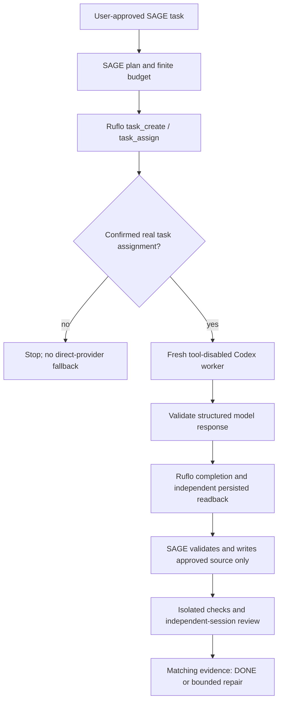

# SAGE × Ruflo — اجرای زندهٔ کنترل‌شده / Controlled live binding

## نقش دقیق اجزا

در بستهٔ توسعهٔ `sage-runtime 0.2.0`، Ruflo یک **هماهنگ‌کنندهٔ واقعی کار** است و
عامل مدل با اتصال فعلی **Codex CLI** اجرا می‌شود. این مسیر، `agent_execute`
داخلیِ Ruflo با Anthropic/OpenRouter/Ollama نیست؛ به کلید تازه نیاز ندارد و
فعال‌بودن همهٔ Agentها، Hookها، حافظهٔ برداری یا Federation را ادعا نمی‌کند.



ثبت نتیجهٔ کار مدل در Ruflo **به معنی پذیرش محصول نیست**؛ این تفاوت در رسید
با `product_acceptance=false` ثبت می‌شود. فقط گیت‌های اصلی SAGE می‌توانند
نتیجهٔ محصول را `DONE` کنند. اگر Ruflo پاسخ معتبر ندهد، کار بی‌صدا به مسیر
مستقیم منتقل نمی‌شود.

## محیط اجرا

- Ruflo دقیقاً `3.61.1`، وابستگی‌های npm با Lockfile و SRI؛ نصب بدون lifecycle scripts.
- ایمیج پایهٔ Node با digest ثابت؛ پس از ساخت، اجرا فقط با شناسهٔ immutable محلی.
- Docker بدون شبکه، بدون دسترسی ریشه، با سقف CPU/RAM/PID و فایل‌سیستم اصلی فقط‌خواندنی.
- فقط پوشهٔ خصوصی metadata همان Run قابل‌نوشتن و Mount است؛ پروژه، سورس SAGE،
  Home و اعتبارنامهٔ مدل Mount نمی‌شوند. Grantها بیرون از Mount نگهداری می‌شوند.
- پنج ابزار مجاز: `task_create`, `task_assign`, `task_status`, `task_complete`, `task_cancel`.
- هر فراخوانی دوباره Approval زمان‌دار و RunContract بومی SAGE را بررسی می‌کند.
- عمر هر سرور محدود است؛ پس از قطع کنترل‌کننده، اجرای بی‌پایان باقی نمی‌ماند.
  در ادامهٔ همان Run، کارهای metadata نیمه‌تمام همان Run لغو می‌شوند؛ فراخوانی
  نامطمئن مدل خودکار تکرار یا از بودجه حذف نمی‌شود.
- prompt، کد، پاسخ مدل و کلیدها به Ruflo فرستاده نمی‌شوند؛ فقط شناسه و هش ثبت می‌شود.
- SENS همچنان مشاهده‌گر اختیاری است؛ مالک اختیار و پذیرش SAGE می‌ماند.

## نصب و استفاده

Docker باید از قبل آماده باشد. این فرمانِ جداگانه اجازهٔ ساخت ایمیج و دریافت
وابستگی‌های قفل‌شده را می‌گیرد؛ **هیچ مدل یا پروژه‌ای اجرا نمی‌کند** و تنظیم
قدیمی را بازنویسی نمی‌کند. والد پوشهٔ خروجی باید وجود داشته باشد:

```powershell
./tools/Initialize-SageRuflo.ps1 -OutputDirectory C:\Temp\sage-ruflo -InstallApproved
python -m pip install ./runtime/autonomous
sage ruflo-probe --ruflo-config C:\Temp\sage-ruflo\ruflo-binding.json --approval-id my-probe --live
sage build "Create a small Python stdlib utility with unittest tests" --output C:\Temp\my-new-app --ruflo-config C:\Temp\sage-ruflo\ruflo-binding.json --approval-id my-local-task --live --profile python-stdlib
```

برنامه و دیاگرام را از نگاشت `artifacts` در خروجی بخوانید و همان هش را تأیید کنید:

```powershell
sage approve RUN_ID --plan-hash PLAN_HASH
sage resume RUN_ID --live
sage status RUN_ID
sage cancel RUN_ID
```

Binding در checkpoint ذخیره می‌شود؛ `resume` همان ایمیج، مسیر و اختیار را
به‌کار می‌گیرد. برداشتن یک Flag، Ruflo را از اجرای قبلی حذف نمی‌کند. برای کار
بدون Ruflo یک Run تازه، بدون `--ruflo-config` بسازید. پیش‌فرض همچنان غیرزنده است.

در نصب مستقل Wheel، منابع ساخت ایمیج هم همراه بسته‌اند. مسیر آن‌ها را با
`python -c "from sage_runtime.cli import default_kit_root; print(default_kit_root() / 'extensions/ruflo/runtime')"`
بیابید و همان Dockerfile/Lockfile را برای ساخت ایمیج استفاده کنید؛ پوشهٔ کامل
کیت نباید به‌عنوان فضای قابل‌نوشتنِ سرور Mount شود.

## مدرک معتبر و محدودیت

`ruflo-probe` فقط اتصال واقعی را ثابت می‌کند؛ نه کدنویسی موفق. آزمون ایزوله با
`tools/Test-SageRufloIsolation.py` و پذیرش کدنویسی با
`tools/Run-SageAutonomousLive.py --ruflo-config ...` جدا هستند. مسیر دوم آزمون
رفتاریِ مستقل از کد مدل، حفظ اصل پروژه، بازبینی جداگانه و بازخوانی Taskهای Ruflo
در یک فرایند تازه را لازم می‌کند. رسید ساختگی یا `success` تنها کافی نیست.

سقف ۱۲، تعداد jobهای مدل در همین تحویل است؛ رزروهای ناموفق بازپرداخت نمی‌شوند.
تکرار HTTP داخلی CLI یا سقف مبلغ حساب به‌طور مستقل تضمین نمی‌شود. نصب یا
بارکردن بسته هیچ مجوزی برای Push، استقرار، اسکن Strix یا پروژهٔ دیگر ایجاد نمی‌کند.

## English operational summary

This is a real Ruflo task-coordinated **external SAGE/Codex worker** binding,
not native Ruflo LLM execution. A fresh network-disabled, non-root Docker process
must create, assign, confirm and persist each model job before SAGE accepts its
result. Only fixed task-metadata tools are callable. No source, prompt or account
credentials enter the coordinator. Product acceptance remains with SAGE's source
scope, isolated checks, independent oracles and fresh-session review.

Install/provision explicitly, pin the resulting local image ID, and pass
`--ruflo-config` on a new build. Resume reuses the stored binding. Offline mode
does not start the server; coordinator failure never silently falls back. This
does not certify every advertised Ruflo feature, all programming stacks, security
or production deployment.
